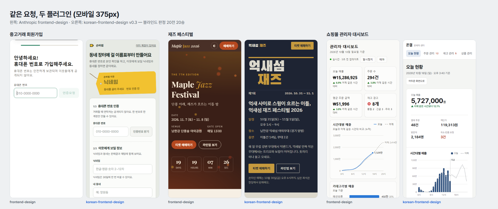

# korean-frontend-design

**개성 있는 디자인 + 한국어 완성도. 한국어 웹 화면을 위한 Claude Code 프론트엔드 디자인 플러그인.**

Anthropic 공식 `frontend-design`의 디자인 방법론(기획 → 검토 → 제작 → 비평, 템플릿 같은 AI 기본값 피하기)을 한국어로 옮기고, 그 플러그인에 없는 한국어 전문성을 더했습니다.

AI가 만든 UI에 한글을 넣으면 생기는 문제들:

- 단어 중간에서 줄이 바뀜 (`안녕하세\n요`)
- 영문 폰트만 지정돼서 한글이 OS 기본 글꼴로 뭉개짐
- 영문 기준 좁은 행간 때문에 답답한 본문
- "당신의 계정이 성공적으로 생성되었습니다" 같은 번역체
- First/Last name, 10/18/2026, $12.99 같은 해외식 입력·표기

- 토스 클론, 보라색 그라데이션, 이모지 3단 카드 같은 "AI가 만든 티"

이 플러그인은 이걸 자동으로 잡아줍니다.

## frontend-design과 맞대결

같은 요청 10개(빵집, 치과, SaaS, 대시보드, 청첩장, 학원, 한옥 숙소, 회원가입, 재즈 페스티벌, 결제)를 두 플러그인에 각각 맡기고, 별도의 Claude가 모바일·데스크톱 스크린샷만 보고 **어느 쪽인지 모르는 상태로** 판정했습니다. 위치 편향을 없애려고 A/B 순서를 바꿔 두 번씩, 총 20회.



| | korean-frontend-design v0.3 | frontend-design |
|---|---|---|
| 판정 승수 (20회) | **20** | 0 |
| 주제에 맞는 개성 | **8.2** | 4.9 |
| 한글 타이포그래피 | **7.6** | 6.2 |
| 한국어 문구 | **8.9** | 6.5 |
| 국내 관행 | **8.3** | 5.8 |
| 완성도 | **7.2** | 6.2 |

10점 만점 평균. 2026-10-18 측정. 판정자도 AI이고 표본이 10개라는 한계가 있으니 참고용으로 봐 주세요. 직접 재현하려면 `eval/` 폴더를 보세요.

## 들어 있는 것

| 구성 | 내용 |
|---|---|
| `SKILL.md` | 주제에서 출발하는 디자인 과정, 한국형 AI 기본값 목록, 한글 기본기(줄바꿈·폰트·행간·자간), 한국어 카피 원칙, 국내 표기·관행 |
| `references/korean-fonts.md` | 성격별 한글 서체 30여 종(로드 확인 완료), 페어링 원칙과 예시 |
| `references/typography.md` | 한글 폰트 선택표와 로드 방법(Pretendard 등), 크기·행간·자간 기준표 |
| `references/ui-patterns.md` | 약관 전체 동의, 사업자 정보 푸터, 하단 고정 CTA, 상품 카드, 소셜 로그인 버튼, 국내식 폼 |
| `references/local-services.md` | 다음 우편번호, 카카오·네이버 로그인, 토스페이먼츠·포트원 결제, 카카오맵·네이버 지도, 카카오톡 공유 |
| `scripts/check_render.py` | 렌더링 검사기 — Chrome으로 375px 화면을 실제로 띄워 가로 넘침, 빈 첫 화면, 숨은 콘텐츠를 잰다 |
| `scripts/check_korean.py` | 결과물 자동 검사기 (lang="ko", keep-all, 한글 폰트, break-all, 번역체, 해외식 표기, 여백 덮어쓰기, AI 기본값 신호) |

## 설치

```bash
/plugin marketplace add rolex0331-cloud/korean-frontend-design
/plugin install korean-frontend-design@korean-frontend-design
```

설치 후 한국어로 화면을 요청하면 자동으로 적용됩니다.

> "카페 원두 쇼핑몰 랜딩 페이지 만들어줘"
> "토스 스타일로 회원가입 화면 만들어줘"

## 검사기만 따로 쓰기

```bash
python skills/korean-frontend-design/scripts/check_korean.py ./src
```

```
ERROR  index.html:1: <html>에 lang="ko"가 없어요
ERROR  전체: 한글 텍스트가 있는데 word-break: keep-all이 없어요 — 단어 중간에서 줄이 바뀝니다
WARN   index.html:2: 번역체 문구 — 자연스러운 한국어로 다듬으세요
```

오류가 있으면 종료 코드 1이라 CI에도 넣을 수 있습니다.

## 이 플러그인이 하는 일과 하지 않는 일

- **데이터를 수집하거나 외부로 보내지 않습니다.** 훅(hook)·MCP 서버·네트워크 요청 코드가 없습니다.
- **스킬(SKILL.md)과 참고 문서**는 Claude가 읽는 텍스트 지침입니다.
- **`check_korean.py`**: 로컬 파일만 읽는 정적 검사기입니다. 네트워크를 쓰지 않고 파일을 수정하지 않습니다.
- **`check_render.py`**: 이 컴퓨터에 설치된 Chrome/Edge를 헤드리스로 실행해 로컬 HTML을 띄우고 화면 폭·보이는 글자 수만 잽니다. 검사 중 임시 HTML 파일 하나를 같은 폴더에 만들었다가 지웁니다. 검사하는 페이지가 웹폰트 등을 CDN에서 불러오면 그 요청은 페이지 자체의 요청입니다.
- **스킬이 만드는 페이지**는 한글 웹폰트를 jsDelivr(cdn.jsdelivr.net)나 Google Fonts에서 불러오도록 안내받습니다. 우편번호·로그인·결제·지도 연동 코드는 각 서비스의 공식 SDK 주소를 안내하며, 키는 환경 변수로 두라고 지시합니다.
- **`eval/` 폴더**는 개발자용 평가 도구입니다. 플러그인 동작에는 쓰이지 않으며, 직접 실행할 때만 `claude` CLI와 Chrome을 호출합니다.

## 평가 직접 돌리기

```bash
claude plugin disable korean-frontend-design@korean-frontend-design   # 공정하게 끄고
bash eval/generate.sh ./results     # 두 플러그인으로 eval/prompts.txt 생성
bash eval/shoot.sh ./results        # 모바일·데스크톱 스크린샷 (Chrome 필요)
bash eval/judge.sh ./results        # 블라인드 판정 (순서 바꿔 2회)
python eval/summarize.py ./results  # 승률·기준별 평균
```

생성·판정 40회가 돌아서 사용량이 꽤 듭니다.

## 라이선스

MIT. 일부 디자인 방법론은 Apache 2.0 라이선스의 anthropics/claude-plugins-official `frontend-design`에서 옮겨 왔습니다. `NOTICE` 참고.
